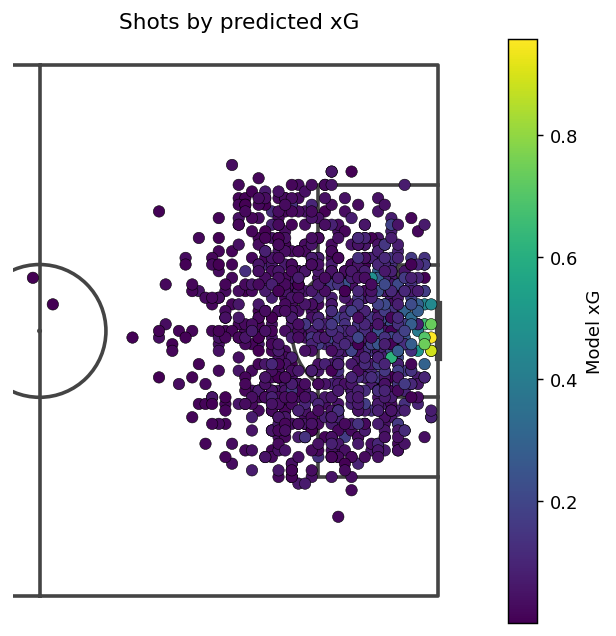
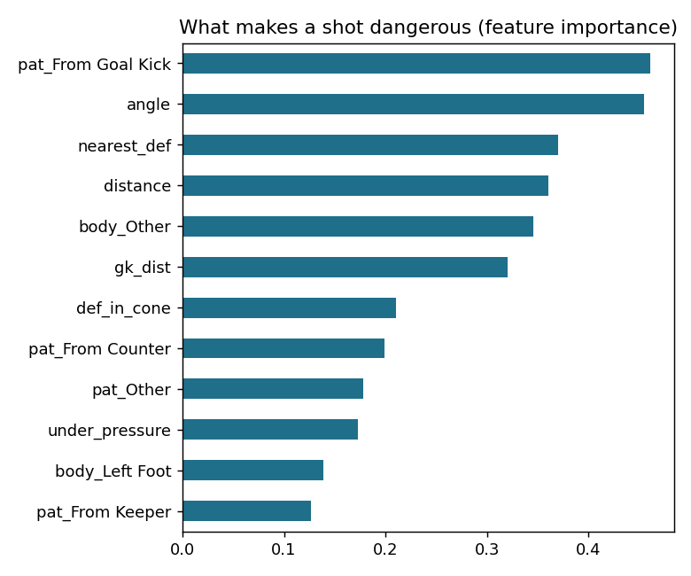
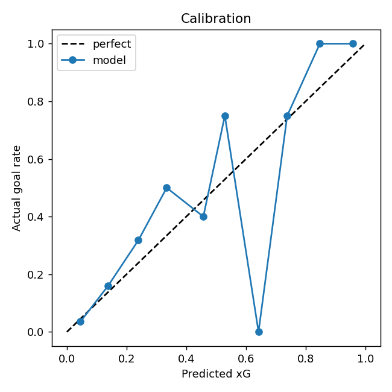
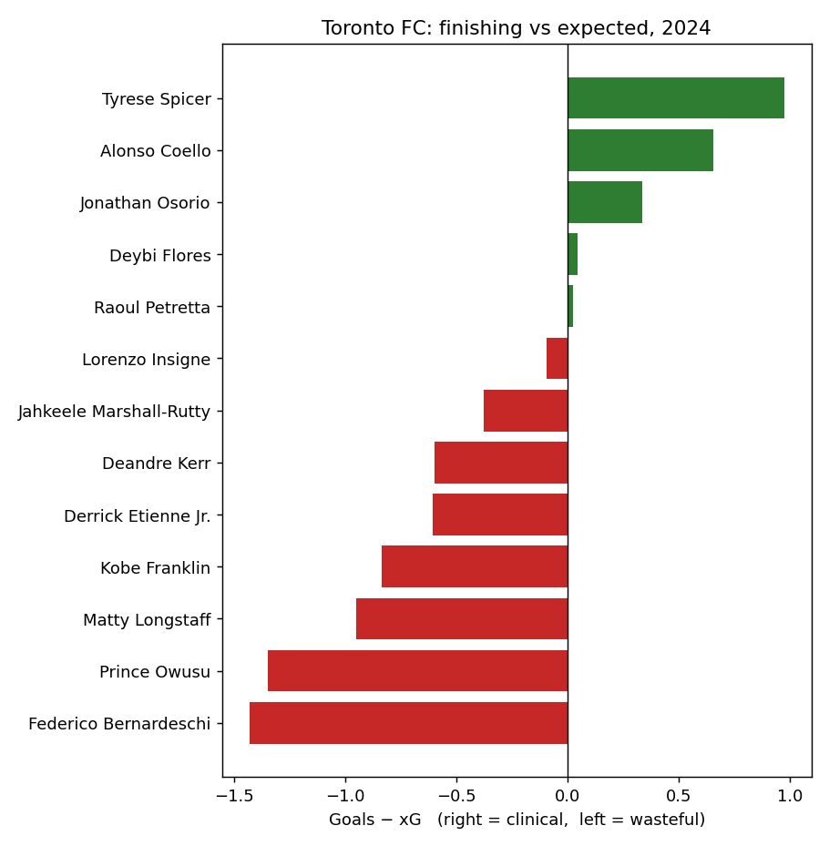

# Expected Goals, Built From Scratch — Then Applied to Toronto FC

**Lethrell Douglas** · 25 years playing (semi-pro, Toronto Lynx) · Data Analysis & AI Specialist

I built my own Expected Goals (xG) model from raw event data, validated it against
StatsBomb's industry xG, and then used xG to answer a question every coach asks:
**who on Toronto FC is actually finishing their chances?**

---

## Part 1 — Building the xG model

**Question:** Given a shot's location, angle, body part, pressure, and the defenders
around it, what's the probability it becomes a goal?

**Data:** StatsBomb Open Data — 1,172 non-penalty shots from the 2018 FIFA World Cup
(45 matches; set `MAX_MATCHES=None` to train on all 64).

**What made the difference:** v1 used only location/angle/body-part and reached
AUC 0.69. Adding *freeze-frame* features — defenders inside the shot-to-goal cone,
distance to the nearest defender, and keeper distance — lifted it to **AUC 0.85**.
That's the gap between a toy xG and a real one, and it matches what you feel as a
striker: it isn't just *where* you shoot from, it's *who's in the way*.

| Model | AUC | Log loss | Brier |
|---|---|---|---|
| Logistic regression (final) | **0.849** | 0.217 | 0.060 |
| Gradient boosting | 0.706 | 0.262 | 0.068 |

A well-featured, interpretable logistic model beat gradient boosting here. The features
mattered more than the algorithm, and with ~1,100 shots the boosted model overfit.

**Sanity check vs the industry:**
- Actual goals (non-penalty): **92**
- My model's total xG: **91.3**
- StatsBomb's total xG: 102.8 (theirs includes penalties, which I excluded)



### What makes a shot dangerous


Shot **angle**, **distance**, **nearest defender**, and **keeper distance** dominate.
(The "From Goal Kick" bar is a small-sample quirk — very few shots come straight off
goal kicks, and a couple went in.)

### Calibration


Predicted xG tracks the actual goal rate closely across the range where most shots live
(0–0.5). The high-xG bins are noisy because few shots are that good — more matches
smooth this out.

---

## Part 2 — Toronto FC: who's finishing their chances?

**Data:** American Soccer Analysis public MLS data, 2024 season, players with 8+ shots.
**Metric:** Goals − xG. Positive = scoring more than the quality of your chances
(clinical). Negative = leaving goals on the pitch.



| Player | Shots | Goals | xG | Goals − xG |
|---|---|---|---|---|
| Tyrese Spicer | 14 | 2 | 1.02 | **+0.98** |
| Alonso Coello | 8 | 1 | 0.34 | +0.66 |
| Jonathan Osorio | 16 | 2 | 1.67 | +0.33 |
| Lorenzo Insigne | 49 | 4 | 4.09 | −0.09 |
| Matty Longstaff | 21 | 2 | 2.95 | −0.95 |
| Prince Owusu | 46 | 9 | 10.35 | −1.35 |
| Federico Bernardeschi | 98 | 8 | 9.43 | **−1.43** |

**The read, from someone who played:**
- The big names carried the shot volume — Bernardeschi took **98 shots**, double anyone
  else — but the whole top of the attack finished *at or below* expectation. The
  chances were there; the conversion wasn't.
- Owusu is the one that stings: 10.35 xG worth of chances for 9 goals. Good positions,
  a few too many left on the table.
- The over-performers (Spicer, Coello, Osorio) are on small samples — a sign to watch,
  not a conclusion. Over 8–16 shots, one goal swings the number.
- The actionable question for a coaching staff isn't "are our forwards good?" — it's
  "why is a 98-shot season producing 8 goals?" Shot selection and shot quality, not
  just finishing.

---

## Honest limitations
- Trained on a 45-match slice; run the full tournament for a stronger model.
- Penalties excluded (modelled separately in production xG).
- Small per-player samples in the TFC table — treat ± under ~1 goal as noise.
- No shot-speed, defender-pressure-intensity, or assist-type features yet (next step).

## Run it
```bash
pip install -r requirements.txt
python xg_model.py          # all matches (or MAX_MATCHES=45 python xg_model.py)
python tfc_analysis.py      # change SEASON inside to any MLS season
```

## Stack
Python · pandas · scikit-learn · matplotlib · mplsoccer · statsbombpy · itscalledsoccer

## Why this project
I spent 25 years reading the game from the pitch. This is me reading it from the data —
and checking whether the numbers say what a player's instincts say. Mostly, they do.
